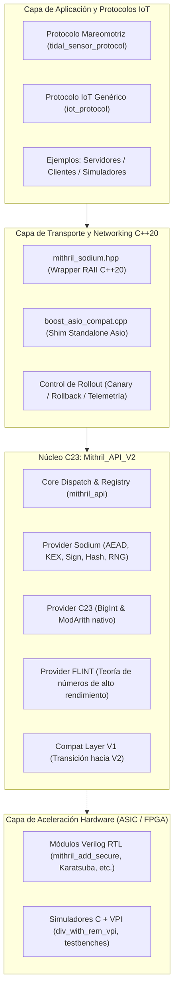
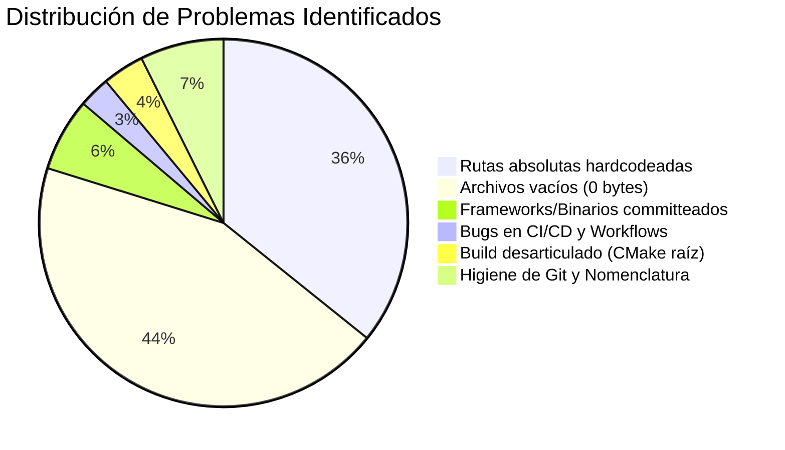
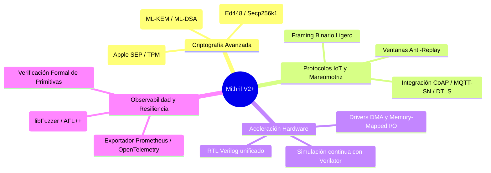
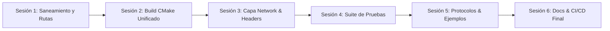

# 📓 Bitácora de Análisis Integral y Hoja de Ruta de Depuración: Proyecto Mithril

**Fecha de Auditoría:** 20 de Octubre de 2026  
**Versión del Proyecto:** 2.0.0 (API V2) / 2.1.0 (Target Global)  
**Estado General:** Sesiones 1 a 4 completadas con éxito. Árbol de Git saneado, sistema CMake raíz unificado, capa de red C++20 modularizada sin esqueletos vacíos y suite exhaustiva de 24 pruebas automatizadas en CTest pasando al 100%. El repositorio se encuentra listo y estabilizado para abordar la **Sesión 5** (Protocolos y Ejemplos de Energía Mareomotriz/IoT).

---

## 📑 Tabla de Contenidos

1. [Propósito y Visión del Proyecto](#1-propósito-y-visión-del-proyecto)
   - 1.1. [¿Qué es Mithril?](#11-qué-es-mithril)
   - 1.2. [Filosofía, Simbolismo y Aplicación en Energía Limpia](#12-filosofía-simbolismo-y-aplicación-en-energía-limpia)
   - 1.3. [Arquitectura de Capas](#13-arquitectura-de-capas)
2. [Radiografía Completa del Repositorio](#2-radiografía-completa-del-repositorio)
   - 2.1. [Mithril_API_V2 (Línea Primaria Activa)](#21-mithril_api_v2-línea-primaria-activa)
   - 2.2. [Capa Network y Consumidores C++20](#22-capa-network-y-consumidores-c20)
   - 2.3. [Mithril_Criptography_API (Línea V1 Obsoleta)](#23-mithril_criptography_api-línea-v1-obsoleta)
   - 2.4. [ASIC implementation (Aceleración Hardware en Verilog)](#24-asic-implementation-aceleración-hardware-en-verilog)
   - 2.5. [Directorio tools, scripts y ci](#25-directorio-tools-scripts-y-ci)
   - 2.6. [Subdirectorios en Estado Esqueleto](#26-subdirectorios-en-estado-esqueleto)
3. [Diagnóstico Exhaustivo: Todo lo que debe Depurarse](#3-diagnóstico-exhaustivo-todo-lo-que-debe-depurarse)
   - 3.1. [Prioridad Crítica: Rutas Absolutas Hardcodeadas](#31-prioridad-crítica-rutas-absolutas-hardcodeadas)
   - 3.2. [Prioridad Crítica: Binarios y Frameworks Gigantes Committeados](#32-prioridad-crítica-binarios-y-frameworks-gigantes-committeados)
   - 3.3. [Prioridad Alta: Sistema de Build Desconectado (CMakeLists.txt raíz vacío)](#33-prioridad-alta-sistema-de-build-desconectado-cmakeliststxt-raíz-vacío)
   - 3.4. [Prioridad Alta: Archivos Fantasma (Esqueletos de 0 Bytes)](#34-prioridad-alta-archivos-fantasma-esqueletos-de-0-bytes)
   - 3.5. [Prioridad Media: Errores e Inconsistencias en CI/CD](#35-prioridad-media-errores-e-inconsistencias-en-cicd)
   - 3.6. [Prioridad Media: Archivos Fuera de Lugar y Nomenclatura](#36-prioridad-media-archivos-fuera-de-lugar-y-nomenclatura)
   - 3.7. [Prioridad Baja / Higiene: Limpieza de Herramientas Antiguas y Licencia](#37-prioridad-baja--higiene-limpieza-de-herramientas-antiguas-y-licencia)
4. [Posibles Ampliaciones y Mejoras Estratégicas](#4-posibles-ampliaciones-y-mejoras-estratégicas)
   - 4.1. [Criptografía Avanzada y Post-Cuántica](#41-criptografía-avanzada-y-post-cuántica)
   - 4.2. [Protocolos Específicos para Redes Mareomotrices e IoT](#42-protocolos-específicos-para-redes-mareomotrices-e-iot)
   - 4.3. [Integración y Validación Hardware (FPGA/ASIC)](#43-integración-y-validación-hardware-fpgaasic)
   - 4.4. [Observabilidad, Telemetría y Ciberresiliencia](#44-observabilidad-telemetría-y-ciberresiliencia)
5. [Plan de Acción por Sesiones (Depuración Paso a Paso)](#5-plan-de-acción-por-sesiones-depuración-paso-a-paso)

---

## 1. Propósito y Visión del Proyecto

### 1.1. ¿Qué es Mithril?
[Mithril](file:///Users/andreibarwood/Documents/snocomm/Mithril/README.md) es una biblioteca y plataforma de seguridad criptográfica diseñada específicamente para proteger dispositivos embebidos e IoT en infraestructuras críticas de generación eléctrica renovable. Su foco inicial y diferencial es la protección de redes de generación mareomotriz (tidal energy), sensores subacuáticos y microredes eléctricas distribuidas.

El sistema resuelve un desafío fundamental: los nodos y sensores en ambientes marinos extremos cuentan con recursos computacionales y energéticos limitados, pero manejan telemetría de control de red que no tolera ataques de inyección, manipulación de mediciones ni ataques de repetición (replay attacks).

### 1.2. Filosofía, Simbolismo y Aplicación en Energía Limpia
- **El Imperativo Geométrico:** En el documento principal se expone el *Teorema de Convergencia Mareomotriz*: la energía nuclear, análoga a un polígono rígido de pocos lados circunscrito en un círculo, acarrea riesgos intrínsecos no lineales y residuos milenarios; en contraste, la energía mareomotriz emula la suavidad infinita del círculo, constante y armónica con los ciclos gravitatorios celestes. Mithril se concibe como el escudo criptográfico para que miles de turbinas y sensores marinos operen con cero fallos de integridad.
- **Etimología:** Su nombre proviene de **Mithra** (𐎷𐎰𐎼), deidad persa garante de los contratos sagrados, la luz, el orden cósmico y la verdad. Del mismo modo, Mithril garantiza que cada paquete de telemetría y cada orden de control entre generadores y estaciones base cumpla estrictamente su contrato criptográfico sin adulteración.

### 1.3. Arquitectura de Capas
La arquitectura conceptual de Mithril está dividida en cuatro estratos interconectados:

---

## 2. Radiografía Completa del Repositorio

El repositorio presenta una dualidad clara: un núcleo moderno muy bien estructurado en [`Mithril_API_V2`](file:///Users/andreibarwood/Documents/snocomm/Mithril/Mithril_API_V2), rodeado de vestigios históricos, scripts manuales y carpetas esqueleto en la raíz.

### 2.1. [`Mithril_API_V2`](file:///Users/andreibarwood/Documents/snocomm/Mithril/Mithril_API_V2) (Línea Primaria Activa)
Es el componente de mayor madurez del proyecto, escrito en estándar **C23** con compilación probada en Clang (macOS Sequoia) y GCC (Ubuntu 24.04):
- **Estructura modular:**
  - `include/mithril/`: Interfaces públicas limpias ([`mithril_api.h`](file:///Users/andreibarwood/Documents/snocomm/Mithril/Mithril_API_V2/include/mithril/mithril_api.h), [`mithril_aead.h`](file:///Users/andreibarwood/Documents/snocomm/Mithril/Mithril_API_V2/include/mithril/mithril_aead.h), [`mithril_sign.h`](file:///Users/andreibarwood/Documents/snocomm/Mithril/Mithril_API_V2/include/mithril/mithril_sign.h), [`mithril_kex.h`](file:///Users/andreibarwood/Documents/snocomm/Mithril/Mithril_API_V2/include/mithril/mithril_kex.h), [`mithril_hash.h`](file:///Users/andreibarwood/Documents/snocomm/Mithril/Mithril_API_V2/include/mithril/mithril_hash.h), [`mithril_rng.h`](file:///Users/andreibarwood/Documents/snocomm/Mithril/Mithril_API_V2/include/mithril/mithril_rng.h), [`mithril_bigint.h`](file:///Users/andreibarwood/Documents/snocomm/Mithril/Mithril_API_V2/include/mithril/mithril_bigint.h), [`mithril_modarith.h`](file:///Users/andreibarwood/Documents/snocomm/Mithril/Mithril_API_V2/include/mithril/mithril_modarith.h)).
  - `src/core/`: Despachador dinámico por proveedor, registro de capacidades, manejo de memoria segura y operaciones constant-time (`core_ct.c`).
  - `src/providers/`: Implementaciones backend desacopladas:
    1. `provider_sodium`: Operaciones criptográficas convencionales apoyadas en `libsodium`.
    2. `provider_c23`: Aritmética de precisión arbitraria en C23 puro sin dependencias externas.
    3. `provider_flint`: Operaciones matemáticas sobre enteros grandes con FLINT (Fast Library for Number Theory).
  - `src/compat/`: Capa de compatibilidad retroactiva para migrar clientes de la API v1.
  - `tests/`: Batería de pruebas unitarias e integración (10 pruebas ejecutables sin FLINT, ampliables a 17 con FLINT activo).

### 2.2. Capa Network y Consumidores C++20
- [`network/include/mithril/mithril_sodium.hpp`](file:///Users/andreibarwood/Documents/snocomm/Mithril/network/include/mithril/mithril_sodium.hpp): Header de más de 1000 líneas que envuelve la API C de Mithril V2 en clases RAII modernas de C++20 ([`KeyExchange`](file:///Users/andreibarwood/Documents/snocomm/Mithril/network/include/mithril/mithril_sodium.hpp#L150), [`AuthenticatedEncryption`](file:///Users/andreibarwood/Documents/snocomm/Mithril/network/include/mithril/mithril_sodium.hpp#L300), [`DigitalSignature`](file:///Users/andreibarwood/Documents/snocomm/Mithril/network/include/mithril/mithril_sodium.hpp#L450), [`CryptoHash`](file:///Users/andreibarwood/Documents/snocomm/Mithril/network/include/mithril/mithril_sodium.hpp#L600)), usando `std::span` y bloqueo de memoria física para evitar swap a disco.
- [`network/src/boost_asio_compat.cpp`](file:///Users/andreibarwood/Documents/snocomm/Mithril/network/src/boost_asio_compat.cpp): Implementación del puente de red Asio que lee variables de entorno de despliegue (`MITHRIL_V2_ROLLOUT_MODE`, `MITHRIL_V2_CANARY_PERCENT`, `MITHRIL_V2_CANARY_KEY`) para habilitar despliegues tipo canary progresivos o rollback instantáneo.
- [`examples/basic/Makefile`](file:///Users/andreibarwood/Documents/snocomm/Mithril/examples/basic/Makefile): Makefile autónomo que descarga Asio standalone si no está presente, compila `Mithril_API_V2` y genera binarios de validación (`accepting_connection_sodium`, `secure_client`, `test_rollout_toggles`, `test_crypto_telemetry`).

### 2.3. [`Mithril_Criptography_API`](file:///Users/andreibarwood/Documents/snocomm/Mithril/Mithril_Criptography_API) (Línea V1 Obsoleta)
- Proyecto histórico de Xcode (`Mithril_Cryptography_API.xcodeproj`).
- Contiene implementaciones aritméticas numeradas (`01_addition.c` a `25_modular_addition.c`).
- Se encuentra formalmente declarada en desuso en [`DEPRECATION_NOTICE_V1.md`](file:///Users/andreibarwood/Documents/snocomm/Mithril/Mithril_Criptography_API/DEPRECATION_NOTICE_V1.md) desde el 18 de marzo de 2026.
- Es el foco principal de peso innecesario en el repositorio (más de 127 MB debido a frameworks precompilados).

### 2.4. [`ASIC implementation`](file:///Users/andreibarwood/Documents/snocomm/Mithril/ASIC%20implementation) (Aceleración Hardware en Verilog)
- Contiene módulos RTL en Verilog (`v1.1-1.v` a `v1.1-12.v`, `01.v`) diseñados por Andres Barbudo para implementar operaciones en hardware en tiempo constante (256 bits, compatibles con curvas Ed25519/Curve25519).
- **Suite de Simulación Icarus Verilog (`iverilog`):** Estructurada en `rtl/`, `tb/`, `vpi/`, con su propio [Makefile](file:///Users/andreibarwood/Documents/snocomm/Mithril/ASIC%20implementation/Makefile) y runner [run_icarus_sim.zsh](file:///Users/andreibarwood/Documents/snocomm/Mithril/ASIC%20implementation/run_icarus_sim.zsh) para simulación de sumador seguro, restador con underflow, adición modular Curve25519, multiplicador Karatsuba, divisor con trampa por cero y una ALU criptográfica completa (`mithril_crypto_alu_top.v`), con volcado de formas de onda `.vcd` para GTKWave.
- Se eliminó la copia binaria redundante de `FLINT.framework` en la Sesión 1.

### 2.5. Directorio [`tools/`](file:///Users/andreibarwood/Documents/snocomm/Mithril/tools), [`scripts/`](file:///Users/andreibarwood/Documents/snocomm/Mithril/scripts) y [`.github/`](file:///Users/andreibarwood/Documents/snocomm/Mithril/.github)
- `tools/`: Colección desorganizada de scripts fechados en agosto y septiembre de 2025 (`01 - 14 August` a `06 - September`) con utilidades personales de gestión de backups, purge de espacio en macOS y linking de Homebrew.
- `scripts/`: Contiene generador de certificados auto-firmados de desarrollo ([`generate_certs.zsh`](file:///Users/andreibarwood/Documents/snocomm/Mithril/scripts/deployment/generate_certs.zsh)) y script keepalive de GitHub Actions ([`keep_github_actions_alive.sh`](file:///Users/andreibarwood/Documents/snocomm/Mithril/scripts/maintenance/keep_github_actions_alive.sh)).
- `.github/workflows/`: Workflows para compilar y testear en Ubuntu y macOS (`mithril-v2-build-test.yml`), pruebas de conformidad nocturnas y keepalive para que GitHub no deshabilite los cron jobs.

### 2.6. Subdirectorios en Estado Esqueleto
Varios módulos están creados como cascarones vacíos (archivos de 0 bytes) debido a inicializaciones prematuras o scripts generadores ([`add_component.zsh`](file:///Users/andreibarwood/Documents/snocomm/Mithril/add_component.zsh), [`.mithril_project_state.json`](file:///Users/andreibarwood/Documents/snocomm/Mithril/.mithril_project_state.json)):
- Raíz [`CMakeLists.txt`](file:///Users/andreibarwood/Documents/snocomm/Mithril/CMakeLists.txt) y [`LICENSE`](file:///Users/andreibarwood/Documents/snocomm/Mithril/LICENSE).
- Todo [`crypto/`](file:///Users/andreibarwood/Documents/snocomm/Mithril/crypto) (5 archivos de 0 bytes).
- Todo [`tests/`](file:///Users/andreibarwood/Documents/snocomm/Mithril/tests) (14 archivos de 0 bytes).
- La mayoría de [`docs/`](file:///Users/andreibarwood/Documents/snocomm/Mithril/docs) (9 archivos de 0 bytes).
- Submódulos de protocolos y headers en [`network/`](file:///Users/andreibarwood/Documents/snocomm/Mithril/network) (12 archivos de 0 bytes).
- Ejemplos de dispositivos IoT y mareomotriz en [`examples/`](file:///Users/andreibarwood/Documents/snocomm/Mithril/examples) (6 archivos de 0 bytes).

---

## 3. Diagnóstico Exhaustivo: Todo lo que debe Depurarse

Esta sección enumera cada ítem técnico que requiere depuración, corrección o limpieza, organizado por criticidad para que en las siguientes sesiones podamos abordar elemento por elemento.

### 3.1. Prioridad Crítica: Rutas Absolutas Hardcodeadas
Existen **más de 39 ocurrencias** de rutas absolutas atadas a directorios de usuarios específicos (`/Users/kirtantegsingh/...` y `/Users/andresbarbudo/...`). Si cualquier otro desarrollador o agente clona el repositorio, estas llamadas fallan inmediatamente:

| Archivo Afectado | Línea(s) | Código Problemático | Corrección Requerida |
| :--- | :--- | :--- | :--- |
| [`README.md`](file:///Users/andreibarwood/Documents/snocomm/Mithril/README.md) | 8-9 | `/Users/kirtantegsingh/documents/mithril/Mithril_API_V2/docs/...` | Cambiar a enlaces relativos `./Mithril_API_V2/docs/...` |
| [`CHANGELOG.md`](file:///Users/andreibarwood/Documents/snocomm/Mithril/CHANGELOG.md) | 32-33 | `/Users/kirtantegsingh/documents/mithril/Mithril_API_V2/docs/...` | Cambiar a enlaces relativos `./Mithril_API_V2/docs/...` |
| [`Mithril_API_V2/README.md`](file:///Users/andreibarwood/Documents/snocomm/Mithril/Mithril_API_V2/README.md) | 56-57, 115, 152, 168-172 | `cd /Users/kirtantegsingh/documents/mithril/Mithril_API_V2`, xcconfig paths | Usar rutas relativas al proyecto |
| [`Mithril_API_V2/README.en.md`](file:///Users/andreibarwood/Documents/snocomm/Mithril/Mithril_API_V2/README.en.md) | 55-56, 114, 151, 167-171 | Rutas idénticas en la versión inglesa | Convertir a rutas relativas |
| [`build_and_run_phase82_with_sodium.zsh`](file:///Users/andreibarwood/Documents/snocomm/Mithril/Mithril_API_V2/scripts/build_and_run_phase82_with_sodium.zsh) | 4 | `ROOT="/Users/kirtantegsingh/documents/mithril/Mithril_API_V2"` | Reemplazar por `ROOT="$(cd "$(dirname "$0")/.." && pwd)"` |
| [`V2_0_MIGRATION_NOTES.md`](file:///Users/andreibarwood/Documents/snocomm/Mithril/Mithril_API_V2/docs/V2_0_MIGRATION_NOTES.md) | 40, 45, 49, 55 | `make -C /Users/kirtantegsingh/...` | Usar rutas relativas |
| [`ROLLOUT_ROLLBACK_RUNBOOK.md`](file:///Users/andreibarwood/Documents/snocomm/Mithril/Mithril_API_V2/docs/ROLLOUT_ROLLBACK_RUNBOOK.md) | 101, 107, 116 | Rutas absolutas en instrucciones de despliegue | Usar `make -C examples/basic test-sprint8` |
| [`SPRINT7_VALIDATION.md`](file:///Users/andreibarwood/Documents/snocomm/Mithril/Mithril_API_V2/docs/SPRINT7_VALIDATION.md) | 10, 18, 31-32 | Rutas absolutas a `examples/basic` | Usar rutas relativas |
| [`SPRINT6_MINIFASE0_COMPAT_SCOPE.md`](file:///Users/andreibarwood/Documents/snocomm/Mithril/Mithril_API_V2/docs/SPRINT6_MINIFASE0_COMPAT_SCOPE.md) | 14, 81, 83, 85 | Rutas absolutas al framework v1 | Usar rutas relativas |
| [`DEPRECATION_NOTICE_V1.md`](file:///Users/andreibarwood/Documents/snocomm/Mithril/Mithril_Criptography_API/DEPRECATION_NOTICE_V1.md) | 22-23 | Rutas absolutas al documento de migración | Usar rutas relativas |
| [`tools/03 - 17 August/14_build_flint_framework_universal.txt`](file:///Users/andreibarwood/Documents/snocomm/Mithril/tools/03%20-%2017%20August/14_build_flint_framework_universal.txt) | Varias | Logs de compilación de `/Users/andresbarbudo/...` | Mover a archivo o eliminar log crudo |

---

### 3.2. Prioridad Crítica: Binarios y Frameworks Gigantes Committeados
El repositorio tiene un peso en disco de más de 150 MB, de los cuales casi el 95% corresponde a binarios compilados que fueron agregados al control de versiones de Git:

1. **Cinco copias completas de FLINT Framework en Git:**
   - [`Mithril_Criptography_API/FLINT.framework`](file:///Users/andreibarwood/Documents/snocomm/Mithril/Mithril_Criptography_API/FLINT.framework)
   - [`Mithril_Criptography_API/FLINT 2.framework`](file:///Users/andreibarwood/Documents/snocomm/Mithril/Mithril_Criptography_API/FLINT%202.framework)
   - [`Mithril_Criptography_API/Mithril_Criptography_API/FLINT.framework`](file:///Users/andreibarwood/Documents/snocomm/Mithril/Mithril_Criptography_API/Mithril_Criptography_API/FLINT.framework)
   - [`Mithril_Criptography_API/Mithril_Framework/FLINT.framework`](file:///Users/andreibarwood/Documents/snocomm/Mithril/Mithril_Criptography_API/Mithril_Framework/FLINT.framework)
   - [`ASIC implementation/FLINT.framework`](file:///Users/andreibarwood/Documents/snocomm/Mithril/ASIC%20implementation/FLINT.framework)
   *Acción requerida:* Eliminar estas copias binarias de Git (`git rm -r --cached`). Las dependencias de FLINT deben ser provistas por el sistema (Homebrew en macOS o `apt-get libflint-dev` en Linux), o descargadas bajo demanda vía CMake `FetchContent`.
2. **Archivo `.xcarchive` de Xcode committeado:**
   - [`Mithril_Criptography_API/Mithril_Criptography_API/Mithril_DynamicLib 2025-08-18 10-19-37/Mithril_DynamicLib 18-08-25, 10.18 AM.xcarchive`](file:///Users/andreibarwood/Documents/snocomm/Mithril/Mithril_Criptography_API/Mithril_Criptography_API/Mithril_DynamicLib%202025-08-18%2010-19-37)
   *Acción requerida:* Eliminar de Git y agregar `*.xcarchive` al [`.gitignore`](file:///Users/andreibarwood/Documents/snocomm/Mithril/.gitignore).
3. **Libro digital `.epub` committeado en la raíz:**
   - [`Mithril releases Report - v1.0.epub`](file:///Users/andreibarwood/Documents/snocomm/Mithril/Mithril%20releases%20Report%20-%20v1.0.epub) (717 KB de binario).
   *Acción requerida:* Trasladar a un release de GitHub o almacenar como documentación markdown si su texto es de interés técnico.
4. **Archivos `.DS_Store` y esquemas de usuario de Xcode committeados:**
   - `Mithril_Criptography_API/.DS_Store`
   - `tools/.DS_Store`
   - `Mithril_Criptography_API/Mithril_Cryptography_API.xcodeproj/xcuserdata/andresbarbudo.xcuserdatad`
   *Acción requerida:* `git rm --cached` de todos los `.DS_Store` y directorios `xcuserdata`.

---

### 3.3. Prioridad Alta: Sistema de Build Desconectado (CMakeLists.txt raíz vacío)
1. **[`CMakeLists.txt`](file:///Users/andreibarwood/Documents/snocomm/Mithril/CMakeLists.txt) en la raíz tiene 0 bytes:**
   - Si un usuario descarga el proyecto y ejecuta `cmake -B build`, la configuración no hace nada.
   - Debe implementarse un `CMakeLists.txt` raíz que declare el proyecto `Mithril`, configure opciones globales (C++20, C23), incluya módulos de warnings y sanitizers, y agregue los subdirectorios:
     - `add_subdirectory(Mithril_API_V2)`
     - `add_subdirectory(network)`
     - `add_subdirectory(examples)`
     - `add_subdirectory(tests)`
2. **Módulos CMake auxiliares vacíos:**
   - [`cmake/CompilerWarnings.cmake`](file:///Users/andreibarwood/Documents/snocomm/Mithril/cmake/CompilerWarnings.cmake) (0 bytes)
   - [`cmake/Sanitizers.cmake`](file:///Users/andreibarwood/Documents/snocomm/Mithril/cmake/Sanitizers.cmake) (0 bytes)
   - [`cmake/modules/FindFLINT.cmake`](file:///Users/andreibarwood/Documents/snocomm/Mithril/cmake/modules/FindFLINT.cmake) (0 bytes)
   - [`cmake/modules/Findsodium.cmake`](file:///Users/andreibarwood/Documents/snocomm/Mithril/cmake/modules/Findsodium.cmake) (0 bytes)
   *Acción requerida:* Rellenar estos módulos con lógica estándar de CMake o utilizar `pkg-config` moderno para `libsodium` y `flint`.
3. **Acoplamiento frágil en [`examples/basic/CMakeLists.txt`](file:///Users/andreibarwood/Documents/snocomm/Mithril/examples/basic/CMakeLists.txt):**
   - Líneas 67-79 buscan el archivo estático `${MITHRIL_REPO_ROOT}/Mithril_API_V2/build-cmake/libmithril_v2.a`. Si no existe ese directorio exacto, el build de CMake falla con un error fatal.
   - Debe resolverse mediante el target nativo `target_link_libraries(target PRIVATE mithril_v2)`.

---

### 3.4. Prioridad Alta: Archivos Fantasma (Esqueletos de 0 Bytes)
El repositorio contaba originalmente con **48 archivos vacíos** que simulaban estructura pero carecían de implementación. El progreso actual ha resuelto los grupos A, B, C y D:

#### Grupo A: Raíz y Licencia ✅ [RESUELTO EN SESIÓN 1]
- [`LICENSE`](file:///Users/andreibarwood/Documents/snocomm/Mithril/LICENSE): Completado con la licencia MIT oficial canónica.

#### Grupo B: Directorio [`crypto/`](file:///Users/andreibarwood/Documents/snocomm/Mithril/crypto) ✅ [RESUELTO EN SESIÓN 2]
- `crypto/CMakeLists.txt`
- `crypto/include/flint_wrapper.h`
- `crypto/include/mithril_crypto.h`
- `crypto/src/flint_wrapper.c`
- `crypto/src/mithril_crypto.c`
*Resolución:* Configurado como biblioteca estática transicional `libmithril_crypto.a` con cabeceras que redirigen limpiamente hacia `Mithril_API_V2` (providers c23 y flint). Cero archivos de 0 bytes.

#### Grupo C: Capa [`network/`](file:///Users/andreibarwood/Documents/snocomm/Mithril/network) ✅ [RESUELTO EN SESIONES 2 Y 3]
- `network/CMakeLists.txt`
- `network/include/mithril/common.hpp`
- `network/include/mithril/crypto_hash.hpp`
- `network/include/mithril/digital_signature.hpp`
- `network/include/mithril/key_exchange.hpp`
- `network/include/mithril/secure_acceptor.hpp`
- `network/include/mithril/secure_session.hpp`
- `network/include/mithril/stream_encryption.hpp`
- `network/src/crypto_hash.cpp`
- `network/src/digital_signature.cpp`
- `network/src/key_exchange.cpp`
- `network/src/secure_acceptor.cpp`
- `network/src/secure_session.cpp`
- `network/src/stream_encryption.cpp`
*Resolución:* El mega-header monolítico fue desglosado en cabeceras modulares y todas las implementaciones fueron escritas en `network/src/`. Se compilan dentro de `libmithril_network.a`. Quedan pendientes para la Sesión 5 únicamente los protocolos de alto nivel (`protocols/tidal_sensor_protocol.hpp` y `protocols/iot_protocol.hpp`).

#### Grupo D: Suite de Pruebas [`tests/`](file:///Users/andreibarwood/Documents/snocomm/Mithril/tests) ✅ [RESUELTO EN SESIÓN 4]
- `tests/CMakeLists.txt`
- `tests/test_helper.hpp`
- `tests/unit/test_encryption.cpp`, `test_hash.cpp`, `test_key_exchange.cpp`, `test_signatures.cpp`, `test_mithril_sodium.cpp`
- `tests/integration/test_concurrent_sessions.cpp`, `test_error_handling.cpp`, `test_full_handshake.cpp`
- `tests/security/fuzz_protocol.cpp`, `test_mitm_protection.cpp`, `test_replay_attack.cpp`
- `tests/performance/benchmark_encryption.cpp`, `benchmark_latency.cpp`, `benchmark_throughput.cpp`
*Resolución:* Los 14 ejecutables de pruebas y benchmarks fueron implementados al 100%, integrados en CTest y validados con 24/24 pruebas pasando exitosamente. Cero archivos de 0 bytes.

#### Grupo E: Directorio [`examples/`](file:///Users/andreibarwood/Documents/snocomm/Mithril/examples) ⏳ [OBJETIVO SESIÓN 5]
- `examples/basic/async_server_sodium.cpp`, `connecting_client_sodium.cpp`, `echo_server_sodium.cpp`
- `examples/iot_devices/device_simulator.cpp`, `gateway_server.cpp`, `sensor_client.cpp`
- `examples/tidal_energy/control_panel_client.cpp`, `data_aggregator.cpp`, `tidal_sensor_server.cpp`

#### Grupo F: Documentación [`docs/`](file:///Users/andreibarwood/Documents/snocomm/Mithril/docs) ⏳ [OBJETIVO SESIÓN 6]
- `docs/API_REFERENCE.md`, `docs/ARCHITECTURE.md`, `docs/GETTING_STARTED.md`
- `docs/architecture/crypto_layer.md`, `network_layer.md`, `security_model.md`
- `docs/tutorials/basic_server.md`, `framework_usage.md`, `iot_integration.md`
*(Solo `docs/api/mithril_sodium_api.md` tiene contenido).*

---

### 3.5. Prioridad Media: Errores e Inconsistencias en CI/CD
1. **Versión inexistente en [`.github/workflows/github-actions-keepalive.yml`](file:///Users/andreibarwood/Documents/snocomm/Mithril/.github/workflows/github-actions-keepalive.yml):**
   - Línea 33: `uses: actions/checkout@v7`. La versión v7 no existe (la versión oficial actual es `actions/checkout@v4`). Esto provocará que el workflow falle automáticamente al dispararse.
2. **Disparadores de Push limitados en [`.github/workflows/mithril-v2-build-test.yml`](file:///Users/andreibarwood/Documents/snocomm/Mithril/.github/workflows/mithril-v2-build-test.yml):**
   - Líneas 12-14: El evento `push` solo se activa para la rama `codex/mithril-v2-sprints`. Si se realiza un push directo a `main`, el CI no se ejecuta. Debe añadirse `main` a la lista de ramas de push.
3. **Script [`scripts/testing/run_all_tests.zsh`](file:///Users/andreibarwood/Documents/snocomm/Mithril/scripts/testing/run_all_tests.zsh) frágil:**
   - Hace `cd build && ctest --output-on-failure`. Si el directorio `build` no fue previamente creado y configurado, el script falla sin mensaje orientativo.

---

### 3.6. Prioridad Media: Archivos Fuera de Lugar y Nomenclatura
1. **Archivo `.cpp` en directorio de includes:**
   - [`network/include/mithril/test_mithril_sodium.cpp`](file:///Users/andreibarwood/Documents/snocomm/Mithril/network/include/mithril/test_mithril_sodium.cpp) está ubicado dentro de una carpeta de cabeceras (`include/mithril/`). Debe trasladarse a `tests/unit/test_mithril_sodium.cpp`.
2. **Inconsistencia ortográfica en V1:**
   - Carpeta nombrada `Mithril_Criptography_API` (con "i" en español) frente al proyecto Xcode nombrado `Mithril_Cryptography_API.xcodeproj` (con "y" en inglés).
3. **Espacios en nombres de directorios clave:**
   - [`ASIC implementation`](file:///Users/andreibarwood/Documents/snocomm/Mithril/ASIC%20implementation) contiene un espacio, lo que genera problemas de quoting y escape en scripts de terminal y CMake. Se recomienda normalizar a `asic_implementation` o `hardware/`.
   - `Mithril_Criptography_API/FLINT 2.framework` contiene un espacio.
4. **Falta de ignorar binarios resultantes en `examples/basic/`:**
   - Al ejecutar `make -C examples/basic test-sprint8`, se generan los binarios `test_rollout_toggles` y `test_crypto_telemetry`, los cuales aparecen como archivos no rastreados (`??`) en Git. Deben agregarse a `.gitignore`.

---

### 3.7. Prioridad Baja / Higiene: Limpieza de Herramientas Antiguas y Licencia
1. **Directorio [`tools/`](file:///Users/andreibarwood/Documents/snocomm/Mithril/tools):**
   - Contiene carpetas por fecha (`01 - 14 August` a `06 - September`) con nombres como `01_build_flintFramework_GMP_MPFR_dylib_universalx86_arm_fastCaching_src_rm_tmp_fastRebuild_autodetect-homebrew_universal-universalbinaries.zsh`.
   - Incluye scripts de administración del Mac del desarrollador (`01_xcode_simulators_custom_location.zsh`, `02_gestion_de_backups.zsh`, `03_clean_purgeable_space.zsh`) que no tienen relación con la biblioteca criptográfica. Deben removerse o archivarse fuera del árbol de código.
2. **Completar [`LICENSE`](file:///Users/andreibarwood/Documents/snocomm/Mithril/LICENSE):**
   - Insertar el texto legal oficial de la licencia MIT con el titular de los derechos de autor (Mithril / Andres Barbudo / contributors).

---

## 4. Posibles Ampliaciones y Mejoras Estratégicas

Más allá de la depuración, Mithril tiene un enorme potencial como biblioteca criptográfica especializada. A continuación se presentan las oportunidades de expansión técnica:

### 4.1. Criptografía Avanzada y Post-Cuántica
1. **Transición Post-Cuántica (PQC - NIST FIPS 203 & 204):**
   - Incorporar un proveedor `provider_pqc` con soporte para **ML-KEM** (Kyber) para intercambio de claves y **ML-DSA** (Dilithium) para firma digital en telemetría crítica de energía. El backend FLINT puede ser aprovechado para las operaciones reticulares (lattice-based arithmetic).
2. **Soporte para Hardware de Seguridad (TPM / Secure Enclave):**
   - En macOS: integración nativa con el Secure Enclave (Apple Silicon) mediante `LocalAuthentication` / `Security.framework` para custodia de claves maestras del sensor.
   - En Linux embebido: soporte para PKCS#11 y TPM 2.0 (`tpm2-tss`).

### 4.2. Protocolos Específicos para Redes Mareomotrices e IoT
1. **Definición del Frame de Telemetría Marina ([`tidal_sensor_protocol.hpp`](file:///Users/andreibarwood/Documents/snocomm/Mithril/network/protocols/tidal_sensor_protocol.hpp)):**
   - Estructura binaria compacta y de bajo overhead:
     - Cabecera: DeviceID (8 bytes), Timestamp uint64 (8 bytes), Secuencia uint32 (4 bytes).
     - Payload cifrado con ChaCha20-Poly1305 (lecturas de presión, turbulencia, velocidad de marea, estado de alternadores).
     - Tag de autenticación (16 bytes).
2. **Mecanismo Anti-Replay por Ventana Deslizante:**
   - Los sensores mareomotrices pueden sufrir cortes de enlace intermitentes. Una ventana deslizante de 64 o 128 secuencias con monotonic timestamp garantiza que ningún atacante pueda retransmitir órdenes de compuertas o alterar estados de turbinas.
3. **Transportes Ligeros (CoAP / MQTT-SN / QUIC):**
   - Extender el socket layer de Asio para soportar datagramas UDP autenticados (DTLS o Noise Protocol sobre UDP) para ambientes submarinos donde TCP introduce latencias prohibitivas.

### 4.3. Integración y Validación Hardware (FPGA/ASIC)
1. **Simulación y CI de Hardware con Verilator / Cocotb:**
   - La carpeta [`ASIC implementation`](file:///Users/andreibarwood/Documents/snocomm/Mithril/ASIC%20implementation) contiene código Verilog valioso para sumadores constant-time y multiplicadores Karatsuba. Integrar un runner de CI con Verilator permitiría simular y verificar automáticamente que los módulos de hardware produzcan exactamente las mismas salidas que el `provider_c23` en software.
2. **Capa de Abstracción de Acelerador Hardware:**
   - Crear un `provider_asic` en `Mithril_API_V2` que interactúe a través de `/dev/mithril_accel` o UIOMap con el hardware sintetizado en FPGAs conectadas por PCIe o SPI.

### 4.4. Observabilidad, Telemetría y Ciberresiliencia
1. **Métricas de Rendimiento y Fallos Criptográficos:**
   - Integrar contadores de fallos de descifrado, firmas inválidas y latencias de handshake mediante OpenTelemetry o exportador Prometheus, permitiendo detectar en tiempo real ataques de inyección en turbinas remotas.
2. **Fuzzing Continuo en CI:**
   - Implementar pruebas de fuzzing activo con `libFuzzer` o `AFL++` sobre el despachador de entrada de tramas ([`network/protocols/`](file:///Users/andreibarwood/Documents/snocomm/Mithril/network/protocols/)) para blindar los dispositivos contra payloads malformados.

---

## 5. Plan de Acción por Sesiones (Depuración Paso a Paso)

Para abordar la depuración de forma ordenada, modular y sin regresiones, se recomienda seguir el siguiente orden en futuras sesiones de trabajo:

### 📍 Sesión 1: Saneamiento del Repositorio y Erradicación de Rutas Hardcodeadas
- [x] Reemplazar todas las rutas absolutas (`/Users/kirtantegsingh/...` y `/Users/andresbarbudo/...`) por rutas relativas en READMEs, scripts de build y documentos de migración.
- [x] Eliminar de Git los 5 frameworks precompilados de FLINT y el archivo `.xcarchive` (`git rm -r --cached`).
- [x] Eliminar archivos `.DS_Store` y carpetas `xcuserdata` rastreadas en Git.
- [x] Reubicar o eliminar el binario `Mithril releases Report - v1.0.epub` (reubicado a `docs/archive/` e ignorado en Git).
- [x] Actualizar [`.gitignore`](file:///Users/andreibarwood/Documents/snocomm/Mithril/.gitignore) para ignorar binarios en `examples/basic/`, archivos `*.epub` y temporales de Xcode.
- [x] Llenar el archivo [`LICENSE`](file:///Users/andreibarwood/Documents/snocomm/Mithril/LICENSE) con la licencia MIT oficial.

### 📍 Sesión 2: Unificación del Sistema de Compilación (CMake Raíz)
- [x] Implementar el [`CMakeLists.txt`](file:///Users/andreibarwood/Documents/snocomm/Mithril/CMakeLists.txt) raíz para gobernar todo el proyecto con un único `cmake -B build`.
- [x] Rellenar [`cmake/CompilerWarnings.cmake`](file:///Users/andreibarwood/Documents/snocomm/Mithril/cmake/CompilerWarnings.cmake) y [`cmake/Sanitizers.cmake`](file:///Users/andreibarwood/Documents/snocomm/Mithril/cmake/Sanitizers.cmake) (además de los módulos de detección `Findsodium.cmake` y `FindFLINT.cmake`).
- [x] Eliminar el acoplamiento frágil en [`examples/basic/CMakeLists.txt`](file:///Users/andreibarwood/Documents/snocomm/Mithril/examples/basic/CMakeLists.txt) hacia el archivo `.a` precompilado, reemplazándolo por el target de CMake `mithril_v2` e integrando la compilación de `network/`.
- [x] Definir el destino del directorio [`crypto/`](file:///Users/andreibarwood/Documents/snocomm/Mithril/crypto) (resuelto como capa paraguas y alias que redirige a `Mithril_API_V2` sin archivos de 0 bytes).

### 📍 Sesión 3: Refactorización y Modularización de la Capa Network
- [x] Trasladar [`network/include/mithril/test_mithril_sodium.cpp`](file:///Users/andreibarwood/Documents/snocomm/Mithril/tests/unit/test_mithril_sodium.cpp) fuera del directorio `include/` y ubicarlo en `tests/unit/` (ahora integrado en CTest como prueba #11).
- [x] Desglosar el mega-header [`mithril_sodium.hpp`](file:///Users/andreibarwood/Documents/snocomm/Mithril/network/include/mithril/mithril_sodium.hpp) en cabeceras individuales modulares:
  - [`common.hpp`](file:///Users/andreibarwood/Documents/snocomm/Mithril/network/include/mithril/common.hpp): Tipos base, claves seguras RAII (`SecureKey`), conceptos C++20, telemetría y utilidades.
  - [`crypto_hash.hpp`](file:///Users/andreibarwood/Documents/snocomm/Mithril/network/include/mithril/crypto_hash.hpp): Primitivas de hashing BLAKE2b y hash multipart.
  - [`digital_signature.hpp`](file:///Users/andreibarwood/Documents/snocomm/Mithril/network/include/mithril/digital_signature.hpp): Firmas digitales Ed25519 y firmado autenticado.
  - [`key_exchange.hpp`](file:///Users/andreibarwood/Documents/snocomm/Mithril/network/include/mithril/key_exchange.hpp): Intercambio de claves ECDH X25519.
  - [`stream_encryption.hpp`](file:///Users/andreibarwood/Documents/snocomm/Mithril/network/include/mithril/stream_encryption.hpp): Cifrado autenticado AEAD XChaCha20-Poly1305 y cifrado por secuencias.
  - [`secure_session.hpp`](file:///Users/andreibarwood/Documents/snocomm/Mithril/network/include/mithril/secure_session.hpp): Sesión TCP segura y corrutinas Asio.
  - [`secure_acceptor.hpp`](file:///Users/andreibarwood/Documents/snocomm/Mithril/network/include/mithril/secure_acceptor.hpp): Aceptador asíncrono para servidores seguros.
  - [`mithril_sodium.hpp`](file:///Users/andreibarwood/Documents/snocomm/Mithril/network/include/mithril/mithril_sodium.hpp): Cabecera paraguas para 100% retrocompatibilidad.
- [x] Escribir las implementaciones correspondientes en `network/src/` eliminando todos los archivos de 0 bytes:
  - [`key_exchange.cpp`](file:///Users/andreibarwood/Documents/snocomm/Mithril/network/src/key_exchange.cpp)
  - [`stream_encryption.cpp`](file:///Users/andreibarwood/Documents/snocomm/Mithril/network/src/stream_encryption.cpp)
  - [`digital_signature.cpp`](file:///Users/andreibarwood/Documents/snocomm/Mithril/network/src/digital_signature.cpp)
  - [`crypto_hash.cpp`](file:///Users/andreibarwood/Documents/snocomm/Mithril/network/src/crypto_hash.cpp)
  - [`secure_session.cpp`](file:///Users/andreibarwood/Documents/snocomm/Mithril/network/src/secure_session.cpp)
  - [`secure_acceptor.cpp`](file:///Users/andreibarwood/Documents/snocomm/Mithril/network/src/secure_acceptor.cpp)
- [x] Verificar compatibilidad completa de compilación con Asio standalone y C++20 (11/11 pruebas en verde, cero warnings).

### 📍 Sesión 4: Implementación de la Suite de Pruebas en [`tests/`](file:///Users/andreibarwood/Documents/snocomm/Mithril/tests)
- [x] Escribir el [`tests/CMakeLists.txt`](file:///Users/andreibarwood/Documents/snocomm/Mithril/tests/CMakeLists.txt) y [`tests/test_helper.hpp`](file:///Users/andreibarwood/Documents/snocomm/Mithril/tests/test_helper.hpp) estructurando las 14 pruebas de la raíz e integrándolas en CTest (elevando la suite total a 24/24 pruebas automatizadas).
- [x] Implementar la totalidad de pruebas unitarias en `tests/unit/`:
  - [`test_encryption.cpp`](file:///Users/andreibarwood/Documents/snocomm/Mithril/tests/unit/test_encryption.cpp): Cifrado AEAD multitamano, no-repetición de nonces, detección de manipulación y `StreamEncryption` secuencial.
  - [`test_hash.cpp`](file:///Users/andreibarwood/Documents/snocomm/Mithril/tests/unit/test_hash.cpp): BLAKE2b-256, efecto avalancha (>25% bits volteados), hash con clave y `MultiPartHash`.
  - [`test_key_exchange.cpp`](file:///Users/andreibarwood/Documents/snocomm/Mithril/tests/unit/test_key_exchange.cpp): Derivación ECDH X25519 bilateral, aislamiento de terceros y cifrado asimétrico directo.
  - [`test_signatures.cpp`](file:///Users/andreibarwood/Documents/snocomm/Mithril/tests/unit/test_signatures.cpp): Firmas Ed25519, rechazo de firmas manipuladas, claves espurias y firmado/cifrado combinado.
  - [`test_mithril_sodium.cpp`](file:///Users/andreibarwood/Documents/snocomm/Mithril/tests/unit/test_mithril_sodium.cpp): Suite de humo de la capa de compatibilidad C++20.
- [x] Implementar pruebas de integración asíncronas en `tests/integration/`:
  - [`test_full_handshake.cpp`](file:///Users/andreibarwood/Documents/snocomm/Mithril/tests/integration/test_full_handshake.cpp): Handshake cliente-servidor Asio loopback completo y mensajería encriptada.
  - [`test_concurrent_sessions.cpp`](file:///Users/andreibarwood/Documents/snocomm/Mithril/tests/integration/test_concurrent_sessions.cpp): Múltiples sesiones asíncronas paralelas concurrentes en `SecureAcceptor`.
  - [`test_error_handling.cpp`](file:///Users/andreibarwood/Documents/snocomm/Mithril/tests/integration/test_error_handling.cpp): Resiliencia ante desconexiones intempestivas, claves truncadas y longitudes sobredimensionadas (>16MB).
- [x] Implementar pruebas de seguridad en `tests/security/`:
  - [`test_replay_attack.cpp`](file:///Users/andreibarwood/Documents/snocomm/Mithril/tests/security/test_replay_attack.cpp): Inmunidad anti-replay entre sesiones mediante secreto efímero y rechazo de duplicados en streaming.
  - [`test_mitm_protection.cpp`](file:///Users/andreibarwood/Documents/snocomm/Mithril/tests/security/test_mitm_protection.cpp): Detección de sustitución de clave pública y autenticación de claves efímeras mediante identidad Ed25519.
  - [`fuzz_protocol.cpp`](file:///Users/andreibarwood/Documents/snocomm/Mithril/tests/security/fuzz_protocol.cpp): Fuzzing mutacional con 1,000+ iteraciones sobre descifrado, verificación y límites de búfer.
- [x] Implementar benchmarks de rendimiento en `tests/performance/`:
  - [`benchmark_latency.cpp`](file:///Users/andreibarwood/Documents/snocomm/Mithril/tests/performance/benchmark_latency.cpp): Latencia promedio en microsegundos de ECDH, firma, verificación, hash y AEAD.
  - [`benchmark_throughput.cpp`](file:///Users/andreibarwood/Documents/snocomm/Mithril/tests/performance/benchmark_throughput.cpp): Rendimiento de flujo continuo masivo (>50 MB/s).
  - [`benchmark_encryption.cpp`](file:///Users/andreibarwood/Documents/snocomm/Mithril/tests/performance/benchmark_encryption.cpp): Escalabilidad de rendimiento AEAD para bloques desde 64 B hasta 1 MB.

### 📍 Sesión 5: Implementación de Protocolos y Ejemplos de Energía Mareomotriz
- [ ] Implementar [`network/protocols/tidal_sensor_protocol.hpp`](file:///Users/andreibarwood/Documents/snocomm/Mithril/network/protocols/tidal_sensor_protocol.hpp) con serialización binaria compacta, HMAC/AEAD y anti-replay.
- [ ] Completar los ejemplos en [`examples/tidal_energy/`](file:///Users/andreibarwood/Documents/snocomm/Mithril/examples/tidal_energy/):
  - `tidal_sensor_server.cpp` (simulación de turbina marina transmitiendo métricas).
  - `control_panel_client.cpp` (consola de mando autorizada recibiendo datos).
  - `data_aggregator.cpp` (nodo concentrador de microred).
- [ ] Completar los ejemplos en [`examples/iot_devices/`](file:///Users/andreibarwood/Documents/snocomm/Mithril/examples/iot_devices/) y los ejemplos básicos pendientes.

### 📍 Sesión 6: Hardening de CI/CD, Documentación y Limpieza Final
- [ ] Corregir `actions/checkout@v7` por `actions/checkout@v4` en [`.github/workflows/github-actions-keepalive.yml`](file:///Users/andreibarwood/Documents/snocomm/Mithril/.github/workflows/github-actions-keepalive.yml).
- [ ] Habilitar el trigger de `push` a la rama `main` en [`.github/workflows/mithril-v2-build-test.yml`](file:///Users/andreibarwood/Documents/snocomm/Mithril/.github/workflows/mithril-v2-build-test.yml).
- [ ] Normalizar nombres de carpetas (`ASIC implementation` a `hardware/` o `asic_implementation/`).
- [ ] Archivar o limpiar los scripts históricos en [`tools/`](file:///Users/andreibarwood/Documents/snocomm/Mithril/tools).
- [ ] Completar la documentación técnica en [`docs/ARCHITECTURE.md`](file:///Users/andreibarwood/Documents/snocomm/Mithril/docs/ARCHITECTURE.md), [`GETTING_STARTED.md`](file:///Users/andreibarwood/Documents/snocomm/Mithril/docs/GETTING_STARTED.md) y [`API_REFERENCE.md`](file:///Users/andreibarwood/Documents/snocomm/Mithril/docs/API_REFERENCE.md).

---

## 6. Estado de la Transición y Punto de Reanudación

### 6.1. Historial de Commits en `main`
| Sesión | Commit | Descripción |
| :--- | :--- | :--- |
| **Sesión 1 + ASIC** | [`bfb5281`](https://github.com/Andrei-Barwood/Mithril/commit/bfb5281) | Erradicación de rutas absolutas, eliminación de binarios Git (>1,470 archivos) y suite Icarus Verilog en `ASIC implementation/`. |
| **Sesión 2** | [`1d02c33`](https://github.com/Andrei-Barwood/Mithril/commit/1d02c33) | CMake raíz unificado, configuración de advertencias/sanitizadores, capa `crypto/` transicional y shims Asio/Boost. |
| **Sesión 3** | [`9bc911d`](https://github.com/Andrei-Barwood/Mithril/commit/9bc911d) | Modularización de `network/include/mithril/`, eliminación del mega-header de 1,012 líneas e implementaciones completas en `network/src/`. |
| **Sesión 4** | [`f497efe`](https://github.com/Andrei-Barwood/Mithril/commit/f497efe) | Suite integral de 14 pruebas en `tests/` (unitarias, integración, seguridad y benchmarks), pasando 24/24 pruebas CTest al 100%. |

### 6.2. Estado Actual del Workspace
* **Rama:** `main` sincronizada con `origin/main` (sin divergencias).
* **Compilación:** `cmake -B build -S . && cmake --build build --parallel` compila limpiamente sin advertencias bajo `-Wall -Wextra`.
* **Pruebas:** `./scripts/testing/run_all_tests.zsh` ejecuta y pasa las 24 pruebas de CTest y las validaciones de ejemplos.
* **Archivos vacíos restantes en el repo:** 11 archivos correspondientes a los ejemplos (`examples/basic/`, `examples/iot_devices/`, `examples/tidal_energy/`), los 2 protocolos de red (`network/protocols/`), y la documentación en `docs/`.

### 6.3. Instrucciones de Reanudación para la Sesión 5
Para reanudar el trabajo en la próxima sesión:
1. Validar estado limpio: `git status` y `./scripts/testing/run_all_tests.zsh`.
2. Implementar [`network/protocols/tidal_sensor_protocol.hpp`](file:///Users/andreibarwood/Documents/snocomm/Mithril/network/protocols/tidal_sensor_protocol.hpp) (protocolo binario con framing AEAD, marcas de tiempo anti-replay y telemetría de turbinas).
3. Implementar [`network/protocols/iot_protocol.hpp`](file:///Users/andreibarwood/Documents/snocomm/Mithril/network/protocols/iot_protocol.hpp).
4. Completar los ejemplos en [`examples/tidal_energy/`](file:///Users/andreibarwood/Documents/snocomm/Mithril/examples/tidal_energy/) y [`examples/iot_devices/`](file:///Users/andreibarwood/Documents/snocomm/Mithril/examples/iot_devices/).

---

*Documento actualizado y consolidado como base de trabajo para el ciclo de estabilización de Mithril.*
