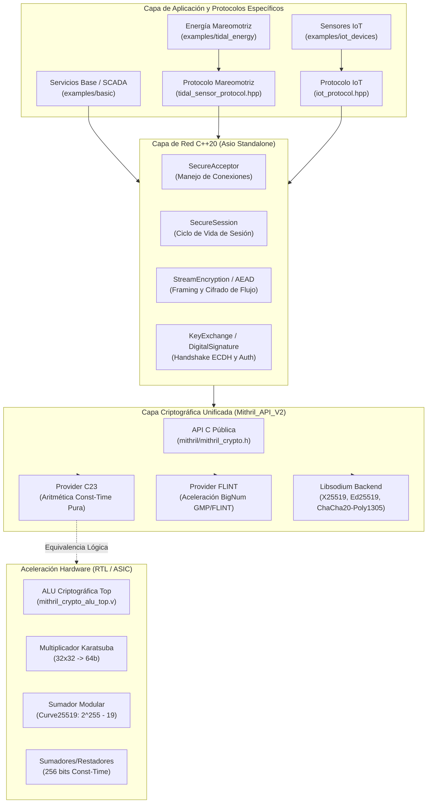
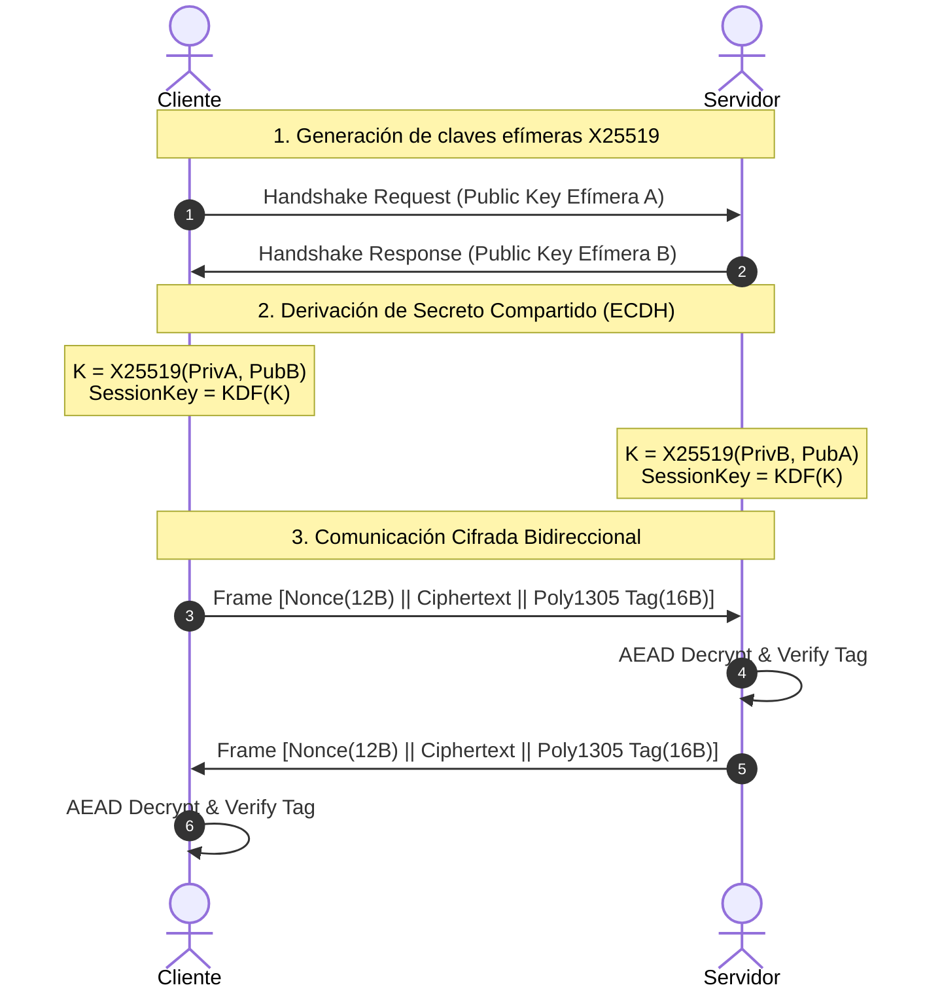

# 🏛️ Arquitectura Global del Sistema Mithril

El ecosistema **Mithril** es una plataforma integral de criptografía de alto rendimiento, aceleración por hardware y comunicaciones de red asíncronas seguras diseñada para infraestructuras críticas, sistemas embebidos de energía mareomotriz y redes de sensores IoT.

---

## 1. Visión Holística del Sistema

Mithril adopta un diseño modular desacoplado en capas jerárquicas estrictas:

---

## 2. Desglose de Capas

### 2.1. Capa de Aplicación y Protocolos Industriales
* **Protocolo Mareomotriz ([`network/protocols/tidal_sensor_protocol.hpp`](file:///Users/andreibarwood/Documents/snocomm/Mithril/network/protocols/tidal_sensor_protocol.hpp)):** Diseñado para telemetría subacuática de turbinas de generación mareomotriz. Implementa serialización binaria compacta (`magic: 0x4D54`), vector de estado de 8 campos métricos (velocidad de flujo, presión de columna de agua, RPM, potencia activa en kW, temperatura y banderas de alternador), autenticación mutua, protección anti-replay con ventana deslizante de 128 paquetes y verificación de firmas Ed25519.
* **Protocolo IoT ([`network/protocols/iot_protocol.hpp`](file:///Users/andreibarwood/Documents/snocomm/Mithril/network/protocols/iot_protocol.hpp)):** Optimizado para nodos de bajo consumo en el borde (*edge computing*), con tramas binarias de sobrecarga mínima (`magic: 0x4D49`), cifrado autenticado ChaCha20-Poly1305 y filtrado de réplicas basado en marcas de tiempo.

### 2.2. Capa de Red Asíncrona C++20 ([`network/`](file:///Users/andreibarwood/Documents/snocomm/Mithril/network))
* Construida enteramente sobre **Asio Standalone** sin dependencia externa obligatoria del framework Boost monolítico.
* Concurrencia dirigida por eventos no bloqueante mediante el `io_context` de Asio.
* **Sesiones Seguras ([`SecureSession`](file:///Users/andreibarwood/Documents/snocomm/Mithril/network/include/mithril/secure_session.hpp)):** Gestionan el estado de conexión del socket, el handshake ECDH y el intercambio autenticado de mensajes sin bloquear el hilo ejecutor.
* **Aceptador Seguro ([`SecureAcceptor`](file:///Users/andreibarwood/Documents/snocomm/Mithril/network/include/mithril/secure_acceptor.hpp)):** Monitorea sockets de escucha TCP y despacha instancias de sesión concurrentes de forma aislada.

### 2.3. Capa Criptográfica Central ([`Mithril_API_V2/`](file:///Users/andreibarwood/Documents/snocomm/Mithril/Mithril_API_V2))
* Diseñada con el patrón de **Proveedores Criptográficos Intercambiables** (*Pluggable Providers*):
  1. `provider_c23`: Implementación en C23 puro, autocontenida, sin dependencias externas, con algoritmos en tiempo constante para mitigar ataques por canal lateral.
  2. `provider_flint`: Acelerador opcional basado en la biblioteca FLINT/GMP para aritmética modular de precisión múltiple.
  3. `libsodium`: Soporte de primitivas estándar de alta velocidad: X25519 (intercambio de claves), Ed25519 (firmas digitales) y ChaCha20-Poly1305 (cifrado AEAD).
* Sanitización de memoria garantizada: las estructuras de claves (`SecureKey`) implementan borrado seguro con ceros (`sodium_memzero`) en sus destructores.

### 2.4. Capa de Hardware y Simulación ASIC ([`hardware/`](file:///Users/andreibarwood/Documents/snocomm/Mithril/hardware))
* Módulos RTL sintetizables en Verilog estándar (IEEE 1364-2005 / SystemVerilog 2012) para sintetizar aceleradores criptográficos en silicio (ASIC) o FPGA:
  - `mithril_add_secure.v` / `mithril_sub_secure.v`: Operaciones de 256 bits en tiempo constante (16 ciclos garantizados).
  - `mithril_add_mod.v`: Reducción rápida sobre el primo de Curve25519 ($2^{255} - 19$).
  - `mithril_karatsuba_mul.v`: Multiplicador Karatsuba segmentado ($32 \times 32 \to 64$ bits en 9 ciclos).
  - `mithril_crypto_alu_top.v`: Unidad Aritmético-Lógica unificada con decodificador de instrucciones y fase de limpieza `CLEANUP` para sobreescritura de registros sensibles.

---

## 3. Modelo de Comunicación y Ciclo del Handshake

El establecimiento de una sesión segura sigue un protocolo de enlace criptográfico de 2 pasos con secreto perfecto hacia adelante (PFS):

---

## 4. Garantías de Seguridad

1. **Confidencialidad:** Cifrado simétrico autenticado ChaCha20-Poly1305 de 256 bits.
2. **Integridad y Autenticación:** Cada trama contiene un tag Poly1305 de 16 bytes que cubre tanto el cuerpo cifrado como los metadatos asociados (AAD). Opcionalmente se añade firma digital Ed25519 para no repudio del sensor.
3. **Resistencia a Replay:** Ventana deslizante bitmask de 128 paquetes y verificación estricta de marcas de tiempo UTC con desvío máximo tolerable de $\pm 60$ segundos.
4. **Resistencia a Canales Laterales:** Primitivas aritméticas de hardware y software implementadas en tiempo constante, evitando ramificaciones condicionadas por valores secretos.
