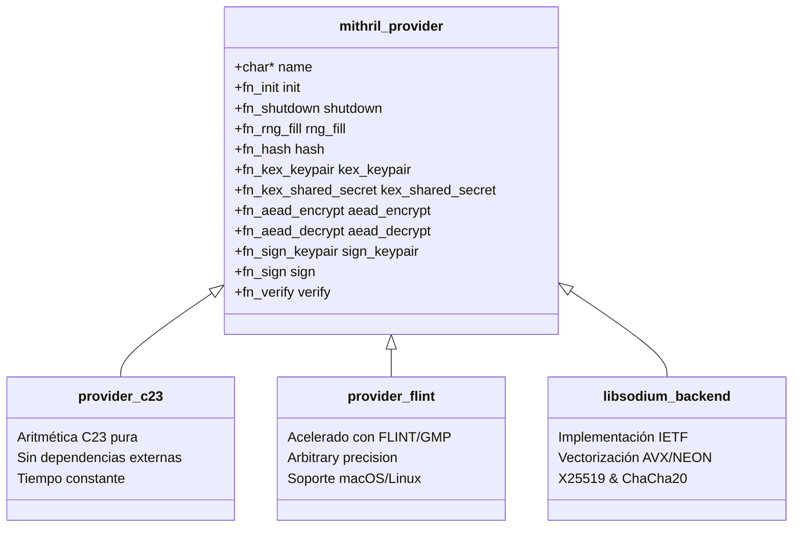

# 🔐 Capa Criptográfica Central (Crypto Layer)

Este documento detalla el diseño, la abstracción y la implementación de la capa criptográfica de Mithril, ubicada en [`Mithril_API_V2/`](file:///Users/andreibarwood/Documents/snocomm/Mithril/Mithril_API_V2) y [`crypto/`](file:///Users/andreibarwood/Documents/snocomm/Mithril/crypto).

---

## 1. Arquitectura de Proveedores Conectables (Pluggable Providers)

Para lograr portabilidad entre entornos embebidos sin dependencias y servidores de alto rendimiento, Mithril implementa una arquitectura basada en interfaz de proveedores criptográficos:

---

## 2. Los Proveedores Disponibles

### 2.1. Proveedor C23 (`provider_c23`)
* **Ubicación:** `Mithril_API_V2/src/providers/c23/`
* **Características:**
  - Escrito de acuerdo con el estándar ISO C23 (`_BitInt`, tipos seguros, límites de desbordamiento explícitos).
  - Autocontenido: no requiere vincular bibliotecas externas.
  - Implementa aritmética de enteros grandes de 256 y 512 bits mediante arrays de `uint64_t` sin desbordamiento indefinido.
  - Diseñado específicamente para sistemas embebidos, microcontroladores y plataformas con restricciones de distribución.

### 2.2. Proveedor FLINT (`provider_flint`)
* **Ubicación:** `Mithril_API_V2/src/providers/flint/`
* **Características:**
  - Utiliza la biblioteca FLINT (*Fast Library for Number Theory*) y GMP (*GNU Multiple Precision Arithmetic Library*).
  - Aceleración de exponenciación modular y reducción sobre campos primos de gran tamaño.
  - Compilación condicional mediante `-DMITHRIL_USE_FLINT=ON`.

### 2.3. Backend Libsodium
* **Ubicación:** `Mithril_API_V2/src/mithril_sodium_backend.c`
* **Características:**
  - Optimizado a nivel de instrucciones SIMD (AVX2, AVX-512, ARM NEON).
  - Garantiza interoperabilidad directa con protocolos de red modernos (TLS 1.3, WireGuard, SSH).

---

## 3. Capa de Compatibilidad y Transición (`crypto/`)

Para asegurar retrocompatibilidad con bases de código históricas que consumían la API V1 (`Mithril_Criptography_API`), el directorio [`crypto/`](file:///Users/andreibarwood/Documents/snocomm/Mithril/crypto) expone una biblioteca puente `libmithril_crypto.a`:

* [`crypto/include/mithril_crypto.h`](file:///Users/andreibarwood/Documents/snocomm/Mithril/crypto/include/mithril_crypto.h): Enruta llamadas a `mithril_init()`, `mithril_provider_activate()` y primitivas V2 de forma transparente.
* Permite una migración incremental sin romper código existente.

---

## 4. Gestión de Claves y Sanitización

Toda manipulación de claves en la capa C++20 está resguardada por la clase plantilla `SecureKey<N>`:
* Deshabilita la copia implícita accidental cuando se transfieren claves efímeras.
* Limpia de forma síncrona el contenido con `sodium_memzero` antes de liberar la memoria.
* Proporciona operadores de comparación en tiempo constante (`sodium_memcmp`) para evitar ataques de temporización al comparar secretos.
