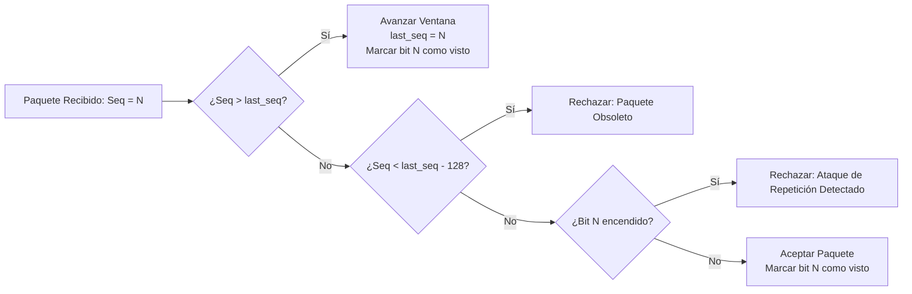

# 🛡️ Modelo de Seguridad y Amenazas de Mithril

Este documento describe formalmente el modelo de amenazas, las primitivas criptográficas seleccionadas, las medidas de mitigación y los controles de ciclo de vida de memoria implementados en Mithril.

---

## 1. Modelo de Amenazas (Threat Model)

Mithril asume el modelo de red abierta hostil de **Dolev-Yao**, donde un adversario activo controla el medio de transmisión físico o inalámbrico y tiene capacidades de:
1. **Intercepción (Eavesdropping):** Leer cualquier paquete en tránsito.
2. **Modificación y Manipulación (Tampering):** Alterar bits de paquetes de telemetría o de control.
3. **Inyección y Falsificación (Spoofing):** Inyectar paquetes espurios o suplantar la identidad de sensores y controladores.
4. **Ataques de Repetición (Replay Attacks):** Capturar paquetes válidos y retransmitirlos con retraso para alterar el estado de turbinas o actuadores industriales.
5. **Ataques de Hombre en el Medio (MitM):** Intentar interceptar el establecimiento de la sesión para sustituir las claves públicas efímeras.
6. **Ataques de Canal Lateral (Side-Channel Timing Attacks):** Medir variaciones en el tiempo de procesamiento aritmético modular para deducir bits de claves privadas.

---

## 2. Primitivas Criptográficas y Niveles de Seguridad

| Primitiva | Algoritmo | Nivel de Seguridad | Propósito en Mithril |
| :--- | :--- | :--- | :--- |
| **Intercambio de Claves** | Curve25519 (X25519) | ~128 bits | Handshake efímero Diffie-Hellman con Secreto Perfecto hacia Adelante (PFS). |
| **Cifrado Autenticado** | ChaCha20-Poly1305 (IETF) | 256 bits (clave) + 128 bits (tag) | Cifrado simétrico de datos y verificación de integridad/autenticidad en una sola pasada. |
| **Firma Digital** | Ed25519 (EdDSA) | ~128 bits | Autenticación de identidad estática y no repudio de telemetría crítica de sensores. |
| **Hashing Criptográfico** | SHA-256 / BLAKE2b | 256 bits | Derivación de claves (KDF) y generación de digests de integridad. |
| **Entropía / RNG** | OS CSPRNG (`/dev/urandom`, `getentropy`) | Criptográficamente seguro | Semillas para generación de claves efímeras y nonces de cifrado. |

---

## 3. Mitigación contra Ataques de Repetición (Anti-Replay)

Mithril implementa una doble defensa contra la reproducción no autorizada de tramas:

### 3.1. Filtro de Ventana Deslizante (Sliding Window Bitmask)
* Cada paquete contiene un número de secuencia monótonamente creciente de 32 o 64 bits.
* El receptor mantiene un registro `last_seq` y una máscara de bits de 128 posiciones:
  - Si un paquete recibido tiene un número de secuencia estrictamente mayor a `last_seq`, la ventana avanza y el bit correspondiente se marca como visto.
  - Si el número de secuencia es anterior a `last_seq - 128`, el paquete se rechaza inmediatamente por obsoleto.
  - Si cae dentro de la ventana de 128 paquetes, se comprueba el bitmask: si el bit ya estaba encendido, el paquete se **descarta como duplicado malicioso**.

### 3.2. Validación de Desvío Temporal (Timestamp Skew)
* Cada trama incluye una marca de tiempo UTC en milisegundos (`timestamp_ms`).
* El receptor compara el timestamp de la trama con su reloj local:
  $$\Delta t = |t_{\text{local}} - t_{\text{trama}}|$$
* Si $\Delta t > 60\,000\text{ ms}$ (1 minuto), la trama se rechaza para mitigar capturas de tráfico prolongadas.

---

## 4. Secreto Perfecto hacia Adelante (Perfect Forward Secrecy - PFS)

En cada conexión nueva:
1. El cliente genera un par de claves efímeras $(sk_c, pk_c)$.
2. El servidor genera un par de claves efímeras $(sk_s, pk_s)$.
3. Intercambian $pk_c$ y $pk_s$ a través de la red.
4. Ambos calculan el secreto compartido $K = \text{X25519}(sk, pk)$.
5. Las claves privadas efímeras $sk_c$ y $sk_s$ se eliminan inmediatamente de la memoria RAM.
6. Si un atacante compromete a largo plazo un dispositivo físico en el futuro, no podrá descifrar las sesiones pasadas capturadas previamente.

---

## 5. Higiene de Memoria y Ataques de Canal Lateral

### 5.1. Borrado Seguro de Memoria (Zeroization)
* El contenedor de claves `SecureKey<N>` implementa el principio RAII (*Resource Acquisition Is Initialization*).
* Al salir del ámbito (scope) o destruir el objeto, su destructor ejecuta `sodium_memzero(data_, N)` para garantizar que el optimizador del compilador no elimine la limpieza de la memoria en la pila o el montón (heap).

### 5.2. Tiempo Constante en Hardware y Software
* El módulo de software `provider_c23` y los módulos RTL de hardware en [`hardware/rtl/`](file:///Users/andreibarwood/Documents/snocomm/Mithril/hardware/rtl) ejecutan la suma modular y el cálculo de Karatsuba mediante un número fijo de ciclos de reloj fijos e independientes del peso Hamming o el valor de los operandos.
* En el módulo `mithril_crypto_alu_top.v`, tras completar la operación se ejecuta el estado `CLEANUP` que reescribe con ceros todos los registros temporales antes de notificar la señal `done`.
